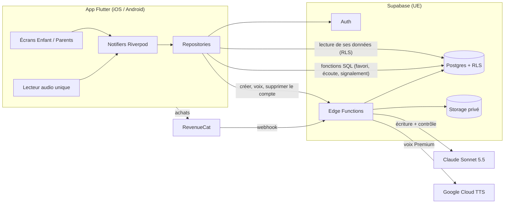

# Architecture — Histoires du Soir

> Phase 3, 20/11/2026. Rôle : mobile-architect. Décisions : `DECISION_LOG.md` (ADR-002 à ADR-019).
> Flux détaillés : `docs/system-design.md` · Données : `docs/data-model.md` · Écrans :
> `docs/design/design-system.md`, `docs/design/flows.md`.

## 1. Vue d'ensemble



**Règle d'or** : l'app ne décide de rien qui coûte ou rapporte. Elle lit ses données (RLS) et
demande au serveur ; quotas, crédits et droits sont tranchés dans Postgres (ADR-003).

## 2. Stack

| Besoin | Choix | Note |
|--------|-------|------|
| Framework | Flutter 3.41 (stable), Dart 3 | |
| État | `flutter_riverpod` | ADR-001, sans génération de code |
| Navigation | `go_router` | |
| Modèles immuables | `freezed` + `json_serializable` | |
| Backend | `supabase_flutter` | session rangée dans `flutter_secure_storage` (ADR-016) |
| Lecture audio | `just_audio` + `audio_session` + `just_audio_background` | lecteur unique, écran verrouillé (ADR-013) |
| Voix standard | `flutter_tts` (synthèse en fichier) | ADR-013 |
| Achats | `purchases_flutter` (RevenueCat) | Inc-5, ADR-009 |
| Connexion parent | `sign_in_with_apple`, `google_sign_in` | Inc-4 |
| Liens externes | `url_launcher` | toujours après contrôle parental |
| Préférences locales | `shared_preferences` | voix, vitesse, taille du texte (non sensibles) |
| Polices | Nunito, Inter intégrées en ressources | ADR-012 |
| Icône et écran de démarrage | `flutter_launcher_icons`, `flutter_native_splash` (outils de dev) | |
| Tests | `flutter_test`, `integration_test`, `mocktail` | |
| Serveur | Edge Functions Deno/TypeScript, SDK `@anthropic-ai/sdk`, `zod` | ADR-002 |

Versions exactes figées à l'installation (phase 4) avec `flutter pub add`.

## 3. Organisation du code

```
lib/
├── main.dart                 # démarrage : config, Supabase, ProviderScope
├── app.dart                  # MaterialApp.router, thème, cycle de vie (retour Espace Enfant, H22)
├── core/
│   ├── config.dart           # valeurs --dart-define (URL et clé publique Supabase, RevenueCat)
│   ├── theme/                # couleurs, typo, dégradés, ThemeData (charte)
│   ├── router.dart           # go_router + garde « Espace Parents »
│   ├── supabase.dart         # client + stockage sécurisé de la session
│   └── failure.dart          # erreurs typées (§6)
├── features/
│   ├── session/              # session anonyme, compte parent, suppression
│   ├── catalog/              # thèmes, personnages, situations, voix
│   ├── stories/              # création, lecture, dernière histoire, favoris, signalement
│   ├── player/               # écoute (standard et Premium)
│   ├── parental_gate/        # défi parental, déverrouillage temporaire
│   ├── parents/              # accueil Parents, paramètres, support, légal
│   └── offers/               # droits, quota, crédits, offre Premium, packs, achats
└── shared/widgets/           # composants du kit : fond nuit, boutons, cartes, tuiles…
```

Chaque feature contient seulement les dossiers dont elle a besoin :
`data/` (repository + modèles freezed), `application/` (providers et notifiers),
`presentation/` (écrans et widgets). Les règles métier pures vont dans `domain/` quand il y en a.
Pas de dépendance circulaire entre features (un écran peut lire les providers d'une autre feature,
comme l'accueil avec les droits) ; ce qui est commun va dans `core/` ou `shared/`.
Pas d'interface abstraite de repository : les tests remplacent les providers (ADR-014).

## 4. Navigation

| Route | Écran | Garde |
|-------|-------|-------|
| `/` | Accueil Enfant | — |
| `/themes` | Choix du thème | — |
| `/creer/:themeId` | Options de création puis attente | — |
| `/histoire/:id` | Lecture + lecteur audio | — |
| `/mes-histoires` | Favoris | — |
| `/personnages` | Personnages | — |
| `/demande-parent` | « Demande à un parent » | — |
| `/controle-parental` | Défi parental | — |
| `/parents` et `/parents/*` (`abonnement`, `packs`, `compte`, `personnages`, `parametres`, `support`, `legal`) | Espace Parents | contrôle parental réussi depuis moins de 5 min et app restée au premier plan |

Le déverrouillage parental vit **en mémoire seulement** ; il est effacé dès que l'app passe en
arrière-plan (H22). Tout lien externe passe par `openExternal()`, qui exige un déverrouillage valide.

## 5. État et données

- **Riverpod** : un provider par source de données ; `AsyncValue` (chargement / données / erreur)
  pour tout ce qui est asynchrone ; `autoDispose` par défaut, `keepAlive` pour le catalogue et les droits.
- **Source de vérité** : Supabase. Pas de base locale (H12) : cache mémoire Riverpod seulement ;
  préférences d'écoute et de lecture dans `shared_preferences`.
- **Droits** (`Entitlements`) : lus dans Supabase, rafraîchis au démarrage, au retour au premier
  plan et après un achat.

## 6. Erreurs

`Failure` (énumération, `lib/core/failure.dart`) : `offline`, `timeout`, `quotaReached`, `locked`,
`contentRejected`, `unexpected` ; complétée quand un incrément en a besoin. Les Edge Functions renvoient un
code d'erreur JSON stable (`QUOTA_REACHED`, `LOCKED`, `ABUSE_LIMIT`, `CONTENT_REJECTED`,
`INVALID_INPUT`, `UPSTREAM_ERROR`) traduit en `Failure`. Aucun détail technique affiché ; messages
doux côté enfant, précis côté parent.

## 7. Configuration et secrets

| Où | Quoi |
|----|------|
| App (`--dart-define-from-file=env/dev.json` ou `env/prod.json`, ignorés par Git ; `env/example.json` versionné) | URL Supabase, clé publique Supabase, clés publiques RevenueCat |
| Secrets des Edge Functions (`supabase/functions/.env` en local, `supabase secrets set` en prod) | clé Anthropic, modèle, clé Google TTS, secret du webhook RevenueCat |
| Jamais dans l'app | clé `service_role`, clés Anthropic / Google / RevenueCat secrètes |

Deux environnements : **dev** (Supabase local sous Docker ; émulateur Android → `10.0.2.2`) et
**prod**. Pas de « flavors » natifs (ADR-015).

## 8. Capacités natives et permissions

| Capacité | Plugin | Permission / réglage |
|----------|--------|----------------------|
| Audio en arrière-plan | `just_audio_background` | iOS : mode « audio » ; Android : service de lecture au premier plan |
| Synthèse vocale | `flutter_tts` | aucune |
| Achats intégrés | `purchases_flutter` | Android : `BILLING` |
| Connexion Apple / Google | `sign_in_with_apple`, `google_sign_in` | capacité « Sign in with Apple » (iOS) |
| Stockage sécurisé | `flutter_secure_storage` | Keychain / Keystore |

Aucune permission sensible (caméra, micro, localisation, contacts, notifications).
