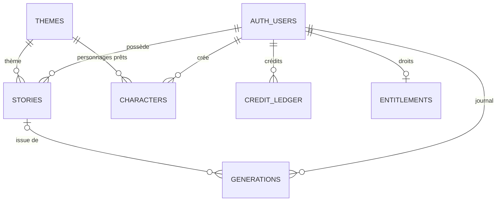

# Modèle de données — Histoires du Soir

> Phase 3, 20/11/2026. Rôle : database-architect. Postgres (Supabase, UE). Les migrations SQL
> (`supabase/migrations/`) et le jeu de données de dev (`supabase/seed.sql`) sont écrits en phase 4,
> table par table, avec leurs tests RLS.

## 1. Schéma

## 2. Dictionnaire

Clés primaires `uuid` (sauf catalogue : identifiant texte lisible). Toutes les tables liées à un
utilisateur ont `user_id → auth.users` **avec suppression en cascade**. Dates en `timestamptz`.

### Catalogue (lecture seule pour l'app, modifié dans Supabase Studio)

| Table | Colonnes |
|-------|----------|
| `themes` | `id` (ex. `animaux`), `name`, `tier` (`free` · `premium` · `seasonal`), `writing_guide` (consignes d'écriture), `illustration` (clé de ressource de l'app, illustration générique si inconnue), `sort_order`, `is_active` |
| `situations` | `id`, `label`, `writing_guide`, `sort_order`, `is_active` |
| `credit_packs` | `product_id` (identifiant store), `scope`, `credits`, `name`, `description`, `sort_order`, `is_active` |
| `voices` | `id`, `name`, `description`, `provider_voice` (voix Google), `speaking_rate`, `sort_order`, `is_active` — voix apaisantes seulement ; la voix du téléphone n'y figure pas |

### Données de l'utilisateur

| Table | Colonnes | Contraintes |
|-------|----------|-------------|
| `characters` | `id`, `user_id` (nul = personnage prêt à l'emploi), `theme_id` (personnages prêts), `name`, `gender` (`girl` · `boy` · `neutral`), `animal`, `trait` (listes fermées), `created_at` | `name` 1 à 20 caractères ; 10 personnages par famille (déclencheur, ADR-031) |
| `stories` | `id`, `user_id`, `theme_id`, `duration_min`, `title`, `paragraphs` (`text[]`, avec le marqueur `{{HEROS}}`), `hero_name`, `hero_gender`, `is_favorite`, `favorited_at`, `listens_count`, `is_hidden`, `created_at` | `duration_min` ∈ {2, 5, 10} ; `hero_name` ≤ 20 caractères |

### Données de gestion (jamais lues directement par l'app)

| Table | Colonnes | Rôle |
|-------|----------|------|
| `generations` | `id`, `user_id`, `request_id`, `source` (`premium` · `free` · `credit`), `credit_scope`, `theme_id`, `duration_min`, `personalized`, `story_id`, `input_tokens`, `output_tokens`, `created_at` | quota hebdomadaire, plafond anti-abus, suivi des coûts ; unique (`user_id`, `request_id`) |
| `generation_attempts` | `id`, `user_id`, `request_id`, `tries`, `created_at`, `finished_at` | tentatives de création : une à la fois, 40 / 24 h en Premium, 10 sinon, échecs compris (ADR-036) ; gardées 2 jours ; unique (`user_id`, `request_id`) |
| `credit_ledger` | `id`, `user_id`, `scope` (`generic` · `premium_themes` · `noel` · `custom`), `delta` (≠ 0), `reason` (`purchase` · `generation` · `refund`), `purchase_event_id`, `generation_id`, `created_at` | solde = somme des `delta` par portée |
| `entitlements` | `user_id`, `premium_until`, `has_voice_pack`, `updated_at` | écrit uniquement par le webhook d'achats |
| `purchase_events` | `event_id`, `user_id`, `type`, `product_id`, `occurred_at` | idempotence du webhook, sans détail de paiement |
| `story_reports` | `id`, `theme_id`, `title`, `paragraphs` (marqueur, **sans prénom ni identifiant**), `reason` (`scary` · `violent` · `inappropriate` · `quality` · `other`), `comment` (≤ 500), `created_at` | analyse des signalements |

## 3. Règles d'accès (RLS activée sur **toutes** les tables)

| Table | Lecture (app) | Écriture (app) |
|-------|---------------|----------------|
| `themes`, `situations`, `voices`, `credit_packs` | utilisateurs connectés (y compris anonymes), lignes actives | aucune |
| `characters` | personnages prêts (`user_id` nul) + les siens | les siens uniquement (`user_id = auth.uid()`) |
| `stories` | les siennes, non masquées | aucune : passe par les fonctions |
| `generations`, `credit_ledger`, `entitlements`, `purchase_events`, `story_reports` | aucune | aucune |

Les écritures sensibles passent par des **fonctions SQL** (`security definer`, `search_path` vide,
droits d'exécution accordés explicitement) :

| Fonction | Appelée par | Effet |
|----------|-------------|-------|
| `my_entitlements()` | app | droits (Premium, Pack Voix), histoires gratuites restantes, crédits par portée, compte anonyme ou non |
| `story_for_voice(user_id, story_id)` | `synthesize-voice` (serveur seul) | texte de l'histoire pour une voix apaisante, ou refus (`LOCKED` sans Premium ni Pack Voix, ou écoute gratuite déjà utilisée) ; n'écrit rien |
| `set_favorite(story_id, valeur)` | app | refuse le 4ᵉ favori hors Premium (`FAVORITES_LIMIT`) |
| `start_listening(story_id)` | app, `synthesize-voice` | refuse une 2ᵉ écoute hors Premium (`LOCKED`) ; sinon compteur + 1 |
| `report_story(story_id, motif, commentaire)` | app | copie l'histoire sans prénom dans `story_reports`, masque l'histoire, retire le favori |
| `start_generation(user_id, request_id)` / `finish_generation(…)` | `generate-story` (serveur seul) | avant tout appel à Claude : demande déjà servie (renvoie l'histoire), une création à la fois (`BUSY`), tentatives bornées (`ABUSE_LIMIT`) ; puis clôture, sans compter si rien n'a été dépensé |
| `precheck_generation(user_id, …)` | `generate-story` (serveur seul) | source de la création ou refus, sans rien écrire |
| `commit_generation(user_id, …)` | `generate-story` (serveur seul) | en une transaction sous verrou : revérifie, journalise, débite le crédit, enregistre l'histoire, supprime les histoires non gardées (H13) et renvoie leurs identifiants |
| `apply_purchase_event(…)` | `purchases-webhook` (serveur seul) | idempotent : droits Premium, Pack Voix, crédits ou remboursement |

## 4. Règles de calcul

- **Semaine gratuite** : générations `free` depuis `date_trunc('week', now() à l'heure de Paris)`,
  soit le lundi 00:00 ; 3 au maximum.
- **Anti-abus Premium** : 30 générations sur 24 heures glissantes (H19).
- **Source d'une création** (H8, H16), dans l'ordre : Premium actif → quota gratuit (thème gratuit,
  2 minutes, sans personnalisation) → crédit `noel` (thème Noël) → crédit `premium_themes` (thème
  Premium, sans personnalisation) → crédit `custom` (histoire personnalisée) → crédit `generic`.
- **Histoires gardées** (H13) : favoris non masqués + la plus récente. Les autres sont supprimées à
  la création suivante, avec leur audio.

## 5. Stockage de fichiers

| Bucket | Accès | Contenu |
|--------|-------|---------|
| `story-audio` (privé) | lecture par chaque famille de son dossier et des extraits (RLS), par URL signée d'une heure ; écriture par `synthesize-voice` seul | `{user_id}/{story_id}-{voice_id}.mp3`, `extraits/{voice_id}.mp3` |

Le chemin fixe sert d'index (pas de table `story_audio`, ADR-035). L'audio part avec l'histoire
(`generate-story`) et avec le compte (`delete-account`). Illustrations et polices sont intégrées à l'app.

## 6. Index

`stories (user_id, created_at desc)` · `stories (user_id) où is_favorite` ·
`generations (user_id, created_at)` · `credit_ledger (user_id, scope)` · `characters (user_id)`.
Chaque index sert une requête de l'app ou d'une fonction ; rien d'autre.

## 7. Conservation des données

| Donnée | Durée |
|--------|-------|
| Histoires non gardées | jusqu'à la création suivante |
| Favoris, personnages, droits, crédits | jusqu'à la suppression du compte |
| Compte anonyme | jusqu'à la désinstallation (session perdue) ; purge des comptes anonymes inactifs depuis 12 mois |
| `generations`, `purchase_events` | 13 mois (suivi des coûts, litiges) |
| `story_reports` (sans données personnelles) | 90 jours |

Purges quotidiennes par `pg_cron`. Ces durées figureront dans la politique de confidentialité.
