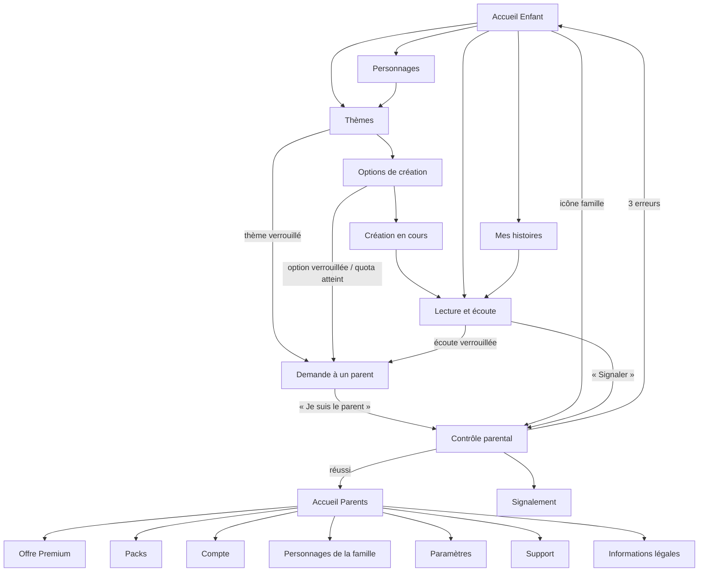

# Parcours et écrans — Histoires du Soir

> Phase 3, 20/11/2026. Rôle : ui-ux-designer. Composants : `design-system.md`.
> Le rendu visuel réel sera validé sur captures d'émulateur dès l'Inc-0, comparées au brand kit.

## 1. Carte de navigation



## 2. Écrans clés

**E1 — Accueil Enfant**
```
┌──────────────────────────────┐
│ ✦        ☾            [👪]   │  icône famille (accès parent)
│   [mascotte renard + lune]   │
│      Histoires du Soir       │  logo texte
│  DES HISTOIRES MAGIQUES …    │  slogan
│        ★ ★ ☆                 │  histoires restantes (gratuit)
│ ┌──────────────────────────┐ │
│ │ ▶  Créer une histoire    │ │  MagicButton
│ └──────────────────────────┘ │
│ ┌──── Ce soir ─────────────┐ │  dernière histoire (si elle existe)
│ │ [illustr.]  Titre…    ♥  │ │
│ └──────────────────────────┘ │
│  [📖]       [🎭]      [♥]    │  IconTile : Thèmes, Personnages, Mes histoires
└──────────────────────────────┘
```

**E5 — Lecture et écoute**
```
┌──────────────────────────────┐
│ ←                    ⚑   ♥   │  retour · signaler (parent) · favori
│  [illustration du thème]     │
│  Le renard et l'étoile       │  titre Nunito ExtraBold
│  Il était une fois, dans …   │  texte crème, défilement
│  …                           │
├──────────────────────────────┤
│  ▶   ━━━━━━━━○──────  1:12   │  AudioPlayerBar (reste visible)
│      Voix : Douce ▾          │  choix de voix (Premium / Pack Voix)
└──────────────────────────────┘
```

**E8 — Demande à un parent**
```
┌──────────────────────────────┐
│     [renard qui sourit]      │
│   Oh ! Cette histoire est    │
│   bien gardée par la lune.   │
│  Demande à un parent de      │
│       venir t'aider. 🌙      │
│ ┌──────────────────────────┐ │
│ │   Je suis le parent      │ │  OutlineButton → C1
│ └──────────────────────────┘ │
│        Retour                │
└──────────────────────────────┘
```

**C1 — Contrôle parental**
```
┌──────────────────────────────┐
│ Espace réservé aux parents   │
│ Combien font                 │
│ « trente-deux plus quinze » ?│
│        [ 4 7 _ ]             │
│   (1) (2) (3)                │
│   (4) (5) (6)                │  ParentalKeypad
│   (7) (8) (9)                │
│       (0)  (⌫)               │
│   Annuler                    │
└──────────────────────────────┘
```

**P1 — Accueil Parents**
```
┌──────────────────────────────┐
│ ← Retour à l'Espace Enfant   │
│ Espace Parents               │
│ ┌ 👑 Premium ─────────────┐  │  état : gratuit / Premium jusqu'au …
│ │ 2 histoires restantes   │  │
│ │ [Passer Premium]        │  │  OutlineButton (non-abonnés)
│ └─────────────────────────┘  │
│ [🎁 Packs]   [👤 Compte]     │
│ [🎭 Personnages]             │
│ [⚙ Paramètres] [💬 Support]  │
│ Informations légales         │
└──────────────────────────────┘
```

**P2 — Offre Premium**
```
┌──────────────────────────────┐
│ ✕          [couronne]        │
│ Créez des histoires          │
│ illimitées pour votre enfant.│
│ ✓ Histoires illimitées       │
│ ✓ Tous les thèmes            │
│ ✓ Histoires de 2, 5, 10 min  │
│ ✓ Voix apaisantes            │
│ ✓ Favoris illimités          │
│ ┌ Annuel  34,99 €/an ──────┐ │  sélectionné par défaut,
│ │ soit 2,92 €/mois  -51 %  │ │  économie affichée
│ └──────────────────────────┘ │
│ ┌ Mensuel 5,99 €/mois ─────┐ │
│ └──────────────────────────┘ │
│ ┌──────────────────────────┐ │
│ │ Essayer 7 jours gratuits │ │  MagicButton
│ └──────────────────────────┘ │
│ Restaurer · Conditions · Confidentialité │
└──────────────────────────────┘
```
Les prix viennent du store ; l'économie est calculée à partir d'eux.

## 3. Autres écrans

| Écran | Contenu | États particuliers |
|-------|---------|--------------------|
| E2 Thèmes | grille de `ThemeCard` (2 colonnes), gratuits en premier | squelette ; thème verrouillé → E8 |
| E3 Options de création | héros (personnages), animal, situation (liste illustrée ou texte du parent), durée 2 / 5 / 10 min ; chaque option verrouillée porte un cadenas | sans personnage : héros par défaut du thème |
| E4 Création en cours | `CreatingAnimation`, phrase rassurante | erreur ou délai > 60 s : `MascotState` + Réessayer ; quota atteint → E8 |
| E6 Mes histoires | liste de cartes (illustration, titre, date), pages de 20 | vide : « Touche le cœur ♥ pour garder une histoire » |
| E7 Personnages | personnages de la famille, puis personnages prêts à l'emploi | aucun personnage de famille : invitation à demander à un parent |
| P3 Packs | 4 cartes : contenu, prix du store, bouton d'achat ; masqué aux abonnés | achat en cours, réussi, annulé, échoué |
| P4 Compte | anonyme : créer un compte (e-mail + code, Apple, Google) ; connecté : e-mail, déconnexion, suppression du compte (double confirmation) | code erroné, compte déjà existant |
| P5 Personnages de la famille | liste + création / modification : prénom (20 car.), fille / garçon / neutre, animal, trait | prénom vide ou trop long |
| P6 Paramètres | voix par défaut (avec extrait), vitesse, taille du texte (aperçu en direct) | — |
| P7 Support | FAQ courte, « Écrire au support » | aucune app e-mail : adresse affichée à copier |
| P8 Informations légales | confidentialité, conditions, mentions légales (liens externes) | — |
| P9 Signalement | motif (5 choix), commentaire facultatif, envoyer | envoi réussi : histoire retirée |
| C2 Hors connexion | `MascotState` « Le ciel est nuageux ce soir… » + Réessayer | — |
