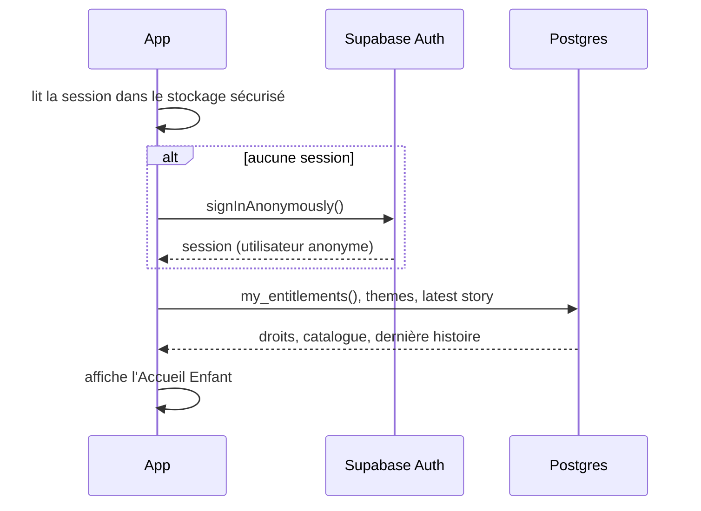
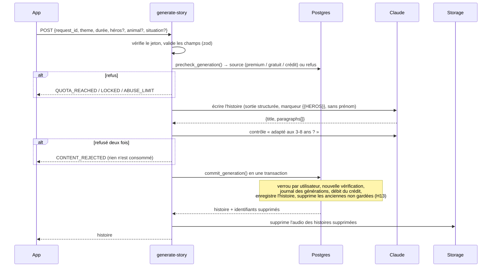
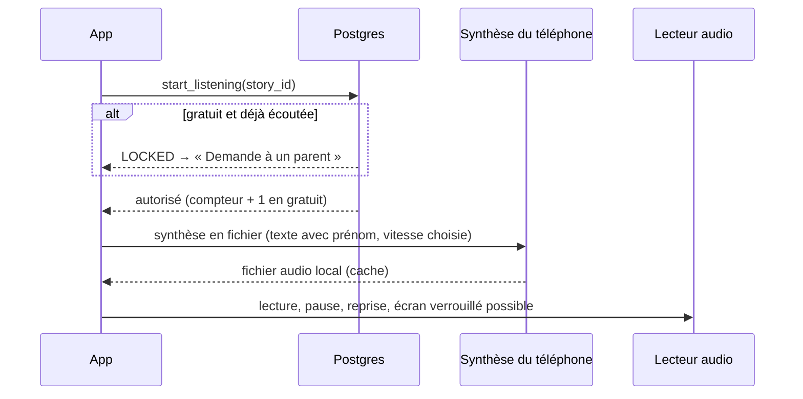
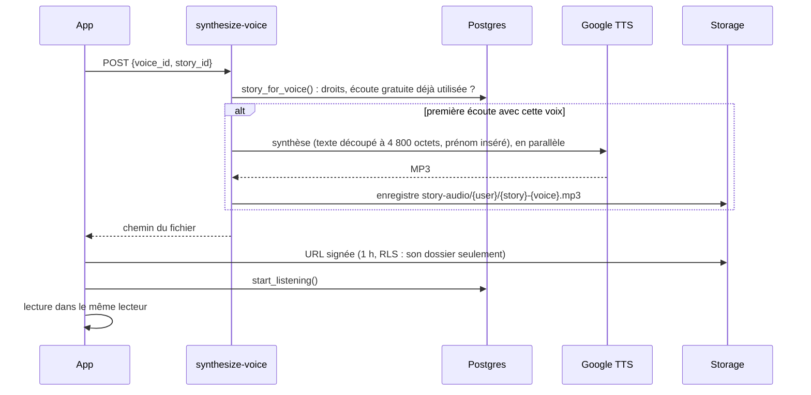
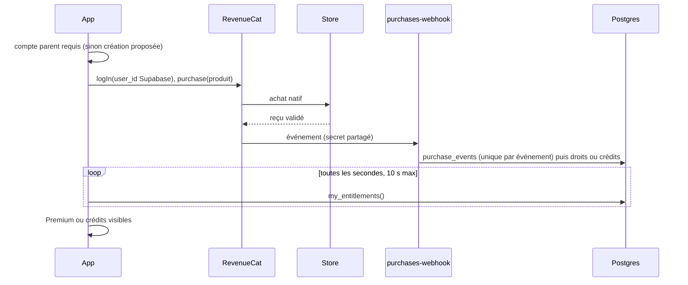
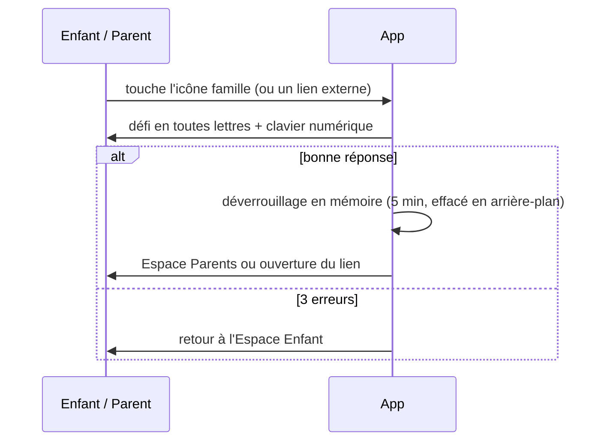

# Conception système — Histoires du Soir

> Phase 3, 20/11/2026. Rôle : system-design. Architecture : `docs/architecture.md` ·
> Données : `docs/data-model.md`.

## 1. Contrats des repositories (méthodes publiques)

Toutes les méthodes sont asynchrones et lèvent une `Failure` typée (architecture §6).

| Repository | Méthodes | Source |
|------------|----------|--------|
| `SessionRepository` | `ensureSession()` (anonyme si absente) · `authState` (flux) · `sendEmailCode(email)` · `verifyEmailCode(email, code)` · `signInWithApple()` · `signInWithGoogle()` · `signOut()` · `deleteAccount()` | Auth, fonction `delete-account` |
| `CatalogRepository` | `themes()` · `presetCharacters()` · `situations()` · `voices()` | tables publiques |
| `FamilyCharactersRepository` | `list()` · `save(character)` · `delete(id)` | table `characters` (RLS) |
| `StoryRepository` | `create(CreateStoryRequest)` → `Story` · `latest()` → `Story?` · `favorites(page)` (20 par page) · `setFavorite(id, bool)` · `report(id, reason, comment)` | fonction `generate-story`, table `stories`, fonctions SQL |
| `ListeningRepository` | `startListening(storyId)` → autorisé ou `locked` · `standardAudioFile(story, settings)` → fichier local · `premiumAudioUrl(storyId, voiceId)` → URL signée | fonction SQL, `flutter_tts`, fonction `synthesize-voice` |
| `OffersRepository` | `entitlements()` → `Entitlements` · `offerings()` · `purchase(productId)` · `restore()` | fonction SQL `my_entitlements`, RevenueCat |

`Entitlements` : `isPremium`, `premiumUntil`, `hasVoicePack`, `freeStoriesLeftThisWeek`,
`credits` par portée (`generic`, `premium_themes`, `noel`, `custom`), `isAnonymous`.

`Story` : `id`, `themeId`, `durationMin`, `title`, `paragraphs`, `heroName?`, `isFavorite`,
`listensCount`, `createdAt`. Le texte stocké contient le marqueur `{{HEROS}}` ; l'app le remplace par
`heroName` à l'affichage et à la synthèse (ADR-017).

## 2. Parcours critiques

### 2.1 Premier lancement (US-01)

### 2.2 Créer une histoire (US-05, US-07, US-32, US-35)

- **Idempotence** : `request_id` (généré par l'app à chaque appui) est unique par utilisateur ;
  un double appui ou une nouvelle tentative ne consomme jamais deux fois.
- **Concurrence** : deux créations simultanées passent le pré-contrôle, mais la transaction finale
  revérifie sous verrou ; la seconde échoue proprement si le quota est épuisé.
- **Délais** : l'app abandonne à 60 s (US-06) ; aucune nouvelle tentative automatique.
- **Prompt** : consignes système fixes (âge, sécurité, structure, durée, accords fille/garçon/neutre),
  puis les choix de l'utilisateur placés dans des balises de données ; le texte libre du parent y
  est cité, jamais exécuté comme consigne.

### 2.3 Écouter avec la voix standard (US-10, US-11)

Repli (R7) : si la synthèse en fichier échoue sur un appareil, lecture directe par `flutter_tts`.

### 2.4 Écouter avec une voix apaisante (US-36, ADR-035)

### 2.5 Acheter (US-25, US-34, US-37)

Correspondance des produits : abonnements → `entitlements.premium_until` ; Pack Voix →
`entitlements.has_voice_pack` ; packs d'histoires → écritures positives dans `credit_ledger`.
Un remboursement de pack ajoute une écriture négative.

### 2.6 Contrôle parental et lien externe (US-16, US-23)

### 2.7 Passer d'une session anonyme à un compte parent (US-20)

L'utilisateur anonyme est **transformé** en compte (Supabase : ajout de l'e-mail vérifié par code,
ou liaison d'une identité Apple / Google) : même identifiant, donc quota, favoris et personnages
conservés. Si le compte existe déjà (connexion sur un 2ᵉ appareil), la session anonyme locale est
abandonnée et le compte existant est chargé.

### 2.8 Supprimer le compte (US-21)

`delete-account` (clé `service_role`, côté serveur) : supprime les fichiers audio de l'utilisateur,
puis l'utilisateur Auth ; les tables suivent par suppression en cascade. Les signalements ne
contiennent ni prénom ni identifiant et sont conservés 90 jours.

## 3. Asynchrone, cache, pagination, résilience

| Sujet | Règle |
|-------|-------|
| États | `AsyncValue` sur chaque écran : chargement, vide, erreur (avec réessayer), données |
| Cache | catalogue et droits gardés en mémoire ; audio standard en fichiers temporaires ; audio Premium sur le serveur |
| Pagination | favoris par pages de 20, triés du plus récent au plus ancien |
| Temps réel | aucun (inutile ici) |
| Délais | 60 s pour créer, 20 s pour la voix Premium, 10 s pour le reste |
| Nouvelles tentatives | automatiques seulement pour les lectures (2 fois) ; jamais pour une création ou un achat |
| Hors connexion | `Failure.offline` → écran ou bandeau doux ; rien n'est consommé (NF-06) |
